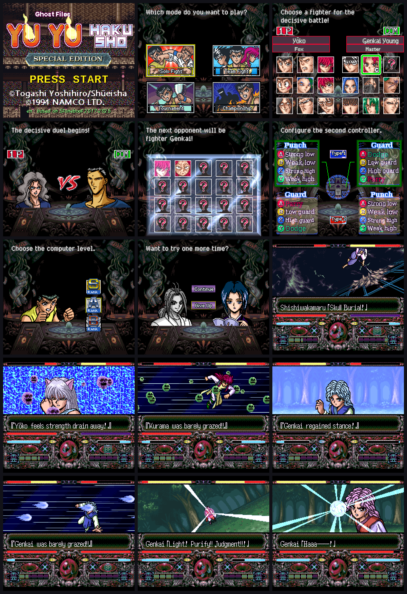

# Yū Yū Hakusho Tokubetsu-hen - English (enUS) - v1.0

Fan/faithful style: romanized names (Yūsuke, Rei Gan, Jagan...), literal move names. Derived from the PT-BR project (itself built on stoneboat65816's Vietnamese project).

Patch: `patch/Yuyu_enUS_v1.0.ips` — apply to a headerless 2 MB Japanese ROM (2,097,152 bytes). The patched ROM is 3,679,968 bytes. Older patches (v0.1-v0.9) are kept in the same folder.

Status:
- [x] Battle text, names, intro and narrator texts
- [x] Opening (voice cast, credits, title screen, move-list demos) and ending credits
- [x] END screen, Tournament result texts
- [x] Fight HUD labels under the bars (kanji + abbreviation, in the bar colours): 体力 HP (Life Points), 気 BP (Balance Points), 霊 MP (Spiritual Energy Points). The orbs are the same three: red 愛 recovers 体力, teal 気 recovers 体勢 (balance), yellow 霊 recovers 霊気 (spiritual energy)
- [x] Romaji (furigana) line above the move names and battle messages, as in the PT-BR version
- [x] Hiei's "Evil King" moves renamed to "Evil Flame" (move list and battle); move-list highlight no longer leaves white pixels on the left
- [x] Menu plates, arena names, fighter select names/titles, team screens, button configuration, sound-test screen (all in the game's pixel font)
- [x] Built and tested in an emulator

Notes:
- title.asm = ptBR/title.asm without the NAMCO/PRESENTED patch (those two screens stay in the original Japanese). Replace ptBR's title.asm with this one in the build folder.
- The `enUS` folder is the full buildable project (asm, binaries, texts, bat). The patch folder contains only the IPS files.

Credits: sniperdmaa / maioni (translation, graphics, testing); stoneboat65816 (base project); Namco / Yoshihiro Togashi (original game and manga).
