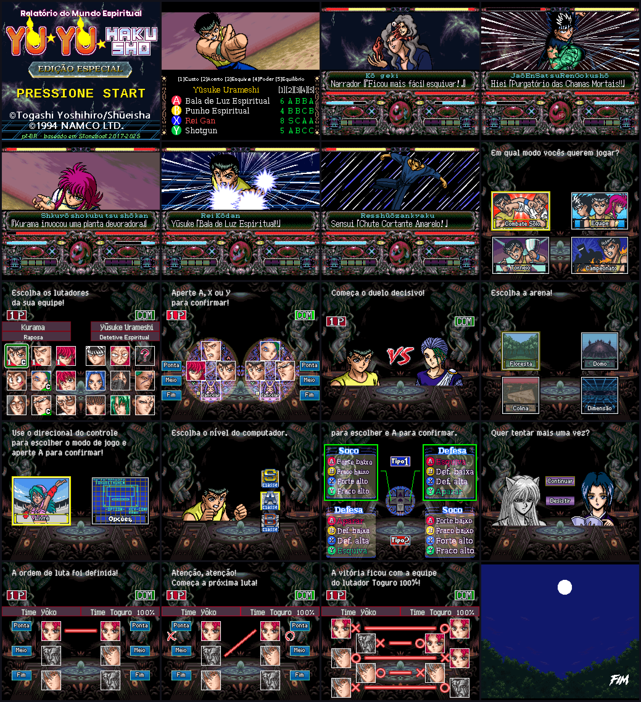

# PT-BR Translation — Yū Yū Hakusho Tokubetsu-hen (SFC)

🇧🇷 [Leia em português](README_PTBR.md)

Current version: **5.1**. A Brazilian Portuguese translation of the Super Famicom fighting game *Yū Yū Hakusho: Tokubetsu-hen*, based on stoneboat65816's Vietnamese project.
This folder is self-contained: nothing outside `ptBR/` was changed, so the Vietnamese project remains intact at the repository root.

> This repository does **not** contain the game ROM. You need your own copy.

## What was changed
- All battle dialogue and narration translated, using a variable-width font with accents (á é í ó ú ã õ â ê ô à ç).
- Special move names shown in romaji above the Portuguese text, using the game's own furigana mechanism.
- Menus, character select, team order screens, difficulty and button config screens redrawn in Portuguese.
- New title screen logo and text, new "FIM" ending graphic, reworked presentation screen.
- Move lists on the opening demo translated.

## Required tools (official downloads)
The programs are not included in this repository; always download them from their official pages:
- **Emulator:** [MesenCE](https://github.com/nesdev-org/MesenCE/releases) (used for testing). Download the package for your system, extract it and open the translated ROM. No special configuration or modified emulator needed.
- **IPS patcher (pick one):**
  - [Floating IPS (Flips)](https://github.com/Alcaro/Flips/releases), for Windows and Linux.
  - [Lunar IPS](https://www.romhacking.net/utilities/240/), for Windows.
  - [Rom Patcher JS](https://www.marcrobledo.com/RomPatcher.js/), runs in the browser, nothing to install.
- **Only for Option 2 (building from source):**
  - [Atlas](https://www.romhacking.net/utilities/224/), the text inserter (`Atlas.exe`).
  - [xkas, version 14](https://github.com/devinacker/xkas-plus/releases) (`xkas.exe`).
  - Put both in the same folder as `YuJ.smc` (the original Japanese ROM).

## Option 1 — Apply the IPS patch (easiest)
1. Get the original Japanese ROM, **headerless** (2 MB = 2,097,152 bytes). If it has a 512-byte copier header, remove it first.
2. Download `Yuyu_PTBR_v5.1.ips` (it is in `ptBR/patch/` in this repository).
3. Apply the patch to a **copy** of the ROM with an IPS patcher.
4. The patched ROM is about 3.5 MB. Open it in an emulator (Mesen, Snes9x, SuperZSNES...) or on a flashcart that supports the expanded size.

## Option 2 — Build from source
1. Put the headerless Japanese ROM in this folder (`ptBR/`) and name it `YuJ.smc`.
2. Also put `Atlas.exe` and `xkas.exe` in the folder (see "Required tools").
3. Run `Yuyu_ptBR.bat`. The output is `Yuyu_ptBR.smc`.

The `.bat` copies `YuJ.smc` to `Yuyu_ptBR.smc`, inserts the texts with Atlas (`battle_text_PTBR.txt`, `battle_name_PTBR.txt`, `serifu_PTBR.txt`) and applies code and graphics with xkas (`main.asm`).

## Folder contents
- `battle_text_PTBR.txt`, `battle_name_PTBR.txt`, `serifu_PTBR.txt` + `*.tbl`: PT-BR texts. The `<$..>` codes are the romaji pieces above the move names, and `<name>` is the fighter's name.
- `code.asm`, `title.asm`, `tournament.asm`, `title_patch.asm`: adapted code (variable-width font, romaji, VS, FIM, etc.).
- `Font/`, `Narrator/`, `Opening/`, `Ending/`, `Tournament/`: translated graphics (2bpp/4bpp tiles).
- Remaining `.asm` files: identical to the original project, copied so the folder is self-contained.
- `NOTAS_PTBR.md`: version history and translation decisions (in Portuguese).
- `patch/`: the IPS patch.

## Credits
PT-BR translation: sniperdmaa / maioni. Original project: stoneboat65816 (StoneBoat).
Yū Yū Hakusho © Yoshihiro Togashi / Shueisha / Namco. Non-profit fan project.
