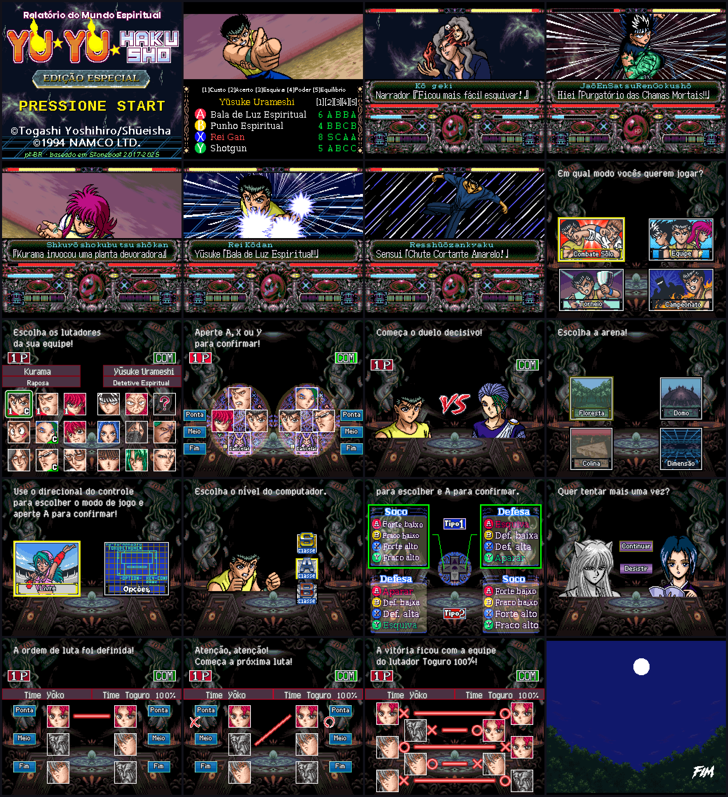

# Tradução PT-BR — Yū Yū Hakusho Tokubetsu-hen (SFC)

🇺🇸 [Read in English](README.md)

Versão atual: **7.0**. Tradução para português do Brasil, baseada no projeto vietnamita de stoneboat65816.
Pasta autônoma: nada fora de `ptBR/` foi alterado, então o projeto vietnamita continua intacto na raiz.

> Este repositório **não** contém a ROM do jogo. Você precisa da sua própria cópia.

## Programas necessários (downloads oficiais)
Os programas não estão neste repositório; baixe sempre das páginas oficiais:
- **Emulador:** [MesenCE](https://github.com/nesdev-org/MesenCE/releases) (usado nos testes). Baixe o pacote do seu sistema, extraia e abra a ROM traduzida. Não precisa de nenhuma configuração ou versão modificada do emulador.
- **Aplicar o patch IPS (escolha um):**
  - [Floating IPS (Flips)](https://github.com/Alcaro/Flips/releases), programa para Windows e Linux.
  - [Lunar IPS](https://www.romhacking.net/utilities/240/), programa para Windows.
  - [Rom Patcher JS](https://www.marcrobledo.com/RomPatcher.js/), direto no navegador, sem instalar nada.
- **Só para a Opção 2 (compilar):**
  - [Atlas](https://www.romhacking.net/utilities/224/), o inseridor de texto (`Atlas.exe`).
  - [xkas, versão 14](https://github.com/devinacker/xkas-plus/releases) (`xkas.exe`).
  - Coloque os dois na mesma pasta do `YuJ.smc` (a ROM japonesa original).

## Opção 1 — Aplicar o patch IPS (mais simples)
1. Tenha a ROM japonesa original **sem header** (2 MB = 2.097.152 bytes). Se tiver header de 512 bytes, remova-o antes.
2. Baixe `Yuyu_PTBR_v7.0.ips` (está em `ptBR/patch/` neste repositório).
3. Aplique o patch na ROM com um programa de patch IPS (por exemplo Lunar IPS ou Floating IPS), em uma **cópia** da ROM.
4. O resultado tem cerca de 3,5 MB. Abra no emulador (Mesen, Snes9x, SuperZSNES...) ou no flashcart.

## Opção 2 — Montar a partir do código
1. Coloque nesta pasta (`ptBR/`) a ROM japonesa sem header, com o nome `YuJ.smc`.
2. Coloque também na pasta `Atlas.exe` e `xkas.exe` (links na seção "Programas necessários").
3. Execute `Yuyu_ptBR.bat`. O resultado é `Yuyu_ptBR.smc`.

O `.bat` copia `YuJ.smc` para `Yuyu_ptBR.smc`, insere os textos com o Atlas (`battle_text_PTBR.txt`, `battle_name_PTBR.txt`, `serifu_PTBR.txt`) e aplica código e gráficos com o xkas (`main.asm`).

## Conteúdo da pasta
- `battle_text_PTBR.txt`, `battle_name_PTBR.txt`, `serifu_PTBR.txt` + `*.tbl`: textos em PT-BR. Os códigos `<$..>` são as peças de romaji sobre os golpes e `<name>` é o nome do lutador.
- `code.asm`, `title.asm`, `tournament.asm`, `title_patch.asm`: código adaptado (fonte de largura variável, romaji, VS, FIM, etc.).
- `Font/`, `Narrator/`, `Opening/`, `Ending/`, `Tournament/`: gráficos já traduzidos (tiles 2bpp/4bpp).
- Demais `.asm`: iguais aos do projeto original, copiados para a pasta ser autossuficiente.
- `NOTAS_PTBR.md`: histórico de versões e decisões de tradução.
- `LEIA-ME.txt`, `LEIA-ME_IMAGENS.txt`, `RUBY_EXEMPLOS.txt`: notas auxiliares.

## Créditos
Tradução PT-BR: sniperdmaa / maioni. Projeto original: stoneboat65816 (StoneBoat).
Yū Yū Hakusho © Yoshihiro Togashi / Shueisha / Namco. Projeto de fãs, sem fins lucrativos.
